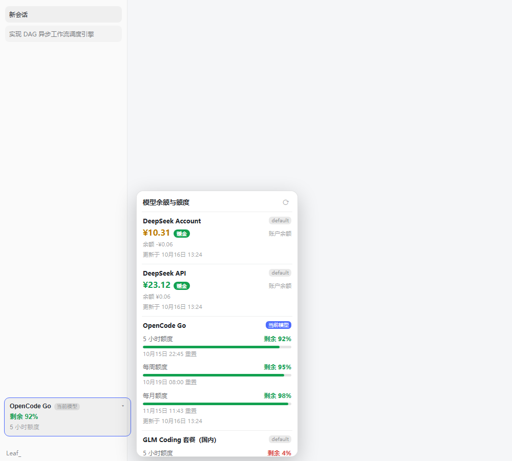
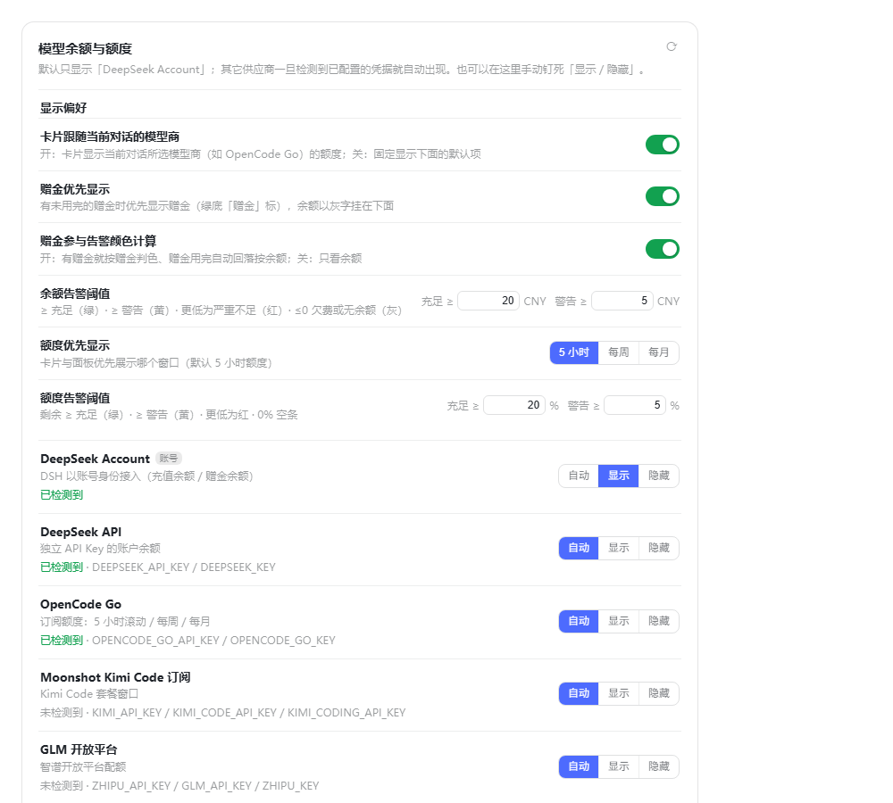

# dsh-model-quota — 模型余额与额度面板

给 DeepSeek Harness Web 界面加一个「模型余额与额度」面板：侧栏底部常驻一张额度卡片，
点一下在右侧展开面板，逐行列出各供应商的**账户余额**或**套餐窗口（5 小时 / 每周 / 每月）
剩余百分比 + 重置时间**。默认只显示 DeepSeek Account，其余供应商一旦检测到已配置的凭据
就自动出现；`设置 → 额度面板` 里可以逐个开关。密钥只在宿主进程内使用，不下发浏览器。





## 安装

### 方式一：GitHub Release（推荐，不需要 npm）

```bash
# 直接装这个 tag 的源码包（本机已实测可用）
dsh plugin --profile <你的 profile 名> add https://codeload.github.com/Leafmy/dsh-model-quota/tar.gz/refs/tags/v1.0.0
```

或者从 [Releases](https://github.com/Leafmy/dsh-model-quota/releases) 下载 `dsh-model-quota-1.0.0.tgz` 再装：

```bash
dsh plugin --profile <你的 profile 名> add ./dsh-model-quota-1.0.0.tgz
```

装完**完全退出并重开 DSH Desktop**（客户端半在启动时组装，刷新页面不够）。

升级：把 URL 里的 tag 换成新版本即可；先把旧版本移除更干净
（`dsh plugin --profile <profile> remove dsh-model-quota` 再 add）。

### 方式二：本地源码 / 手动安装

```bash
dsh plugin --profile desktop add file:/绝对路径/dsh-model-quota
```

手动（不使用插件管理器）：

1. 把包放进 profile 的 `node_modules/`（复制或 junction 都行）：

   ```powershell
   New-Item -ItemType Junction `
     -Path "$env:USERPROFILE\.dsh\profiles\desktop\node_modules\dsh-model-quota" `
     -Target "C:\path\to\dsh-model-quota"
   ```

2. 在 `~/.dsh/profiles/<profile>/package.json` 的 `dsh.profile.bundles` 里加一行 `"dsh-model-quota"`。
3. 重启 DSH Desktop。

> 包自带的 `cordis.patch.yml` 已经 `insert` 了 `id: dsh-model-quota`。**不要在用户层再 insert
> 同一个 id**（重复 id 会让加载器起不来）；要改配置就在 profile 的 `cordis.patch.yml` 里写一条
> 同 id 的覆盖行（见下面「配置」）。

## 它解决什么

同一个 DSH 里往往配了好几个供应商：DeepSeek 按量计费看余额，OpenCode Go / GLM Coding /
Kimi Code 是套餐制看滚动窗口。以前要分别登录各家控制台才能知道「还能不能接着干」。
本插件把这些读数聚合到侧栏一个卡片上，一眼可见。

## 余额怎么显示（赠金优先 + 颜色）

DeepSeek Account / DeepSeek API 这类带「赠金 / 赠送余额」的供应商：

- **有未用完的赠金**且开了「赠金优先显示」→ 大号数字显示**赠金**，右侧一个
  **绿底白字的「赠金」圆角标**；赠金下方以**灰色小字**显示正常余额（非赠金部分）。
- **没有赠金**（或关掉「赠金优先显示」）→ 直接显示正常余额。

**颜色**（数字与「赠金」标同色）：

| 颜色 | 条件（默认阈值） |
|---|---|
| 绿 | 充足：≥ 20 CNY |
| 黄 | 警告：≥ 5 CNY |
| 红 | 严重不足：< 5 CNY |
| 灰 | 没有余额或已欠费（≤ 0） |

「赠金参与告警颜色计算」开关决定用哪个数判色：**开**（默认）→ 有赠金就按赠金判色，
赠金用完自动回落按余额；**关** → 只看余额。阈值本身可在设置页改（默认 20 / 5 CNY）。

## 额度怎么显示（进度条 + 颜色）

套餐型供应商（OpenCode Go / GLM Coding / Kimi Code / MiniMax 等）：

- **优先显示哪个窗口**可在设置页选：5 小时（默认）/ 每周 / 每月；卡片与面板都按它排序。
- **颜色**（默认阈值）：剩余 ≥ 20% 绿 · ≥ 5% 黄 · < 5% 红 · **0% 空条**（不画填充）。
  阈值可在设置页改（默认 20 / 5 %）。

## 供应商目录

| id | 显示名 | 凭据引用 | 接口 | 语义 |
|---|---|---|---|---|
| `deepseek-account` | DeepSeek Account | （账号登录记录） | 宿主 `ctx.deepseekAccount` | 充值 + 赠金余额，**默认常驻** |
| `deepseek` | DeepSeek API | `DEEPSEEK_API_KEY` | `api.deepseek.com/user/balance` | 账户余额（含充值/赠送明细） |
| `moonshot` | Moonshot 开放平台 | `MOONSHOT_API_KEY` | `api.moonshot.cn/v1/users/me/balance` | 账户余额 |
| `kimi-coding` | Moonshot Kimi Code 订阅 | `KIMI_API_KEY` | `api.kimi.com/coding/v1/usages` | 5 小时 / 每周窗口 |
| `glm` | GLM 开放平台 | `ZHIPU_API_KEY`、`GLM_API_KEY` | `open.bigmodel.cn/api/monitor/usage/quota/limit` | 配额剩余（无公开余额接口） |
| `glm-coding-cn` | GLM Coding 套餐（国内） | `GLM_CODING_API_KEY`、`ZAI_CODING_CN_API_KEY` | 同上 | 5 小时 / 每周 / 每月 |
| `zai-coding` | Z.AI GLM Coding（国际） | `ZAI_API_KEY` | `api.z.ai/api/monitor/usage/quota/limit` | 5 小时 / 每周 / 每月 |
| `opencode-go` | OpenCode Go | `OPENCODE_GO_API_KEY` | `opencode.ai/zen/go/v1/usage` | 5 小时滚动 / 每周 / 每月 |
| `openrouter` | OpenRouter | `OPENROUTER_API_KEY` | `openrouter.ai/api/v1/credits` | 已购 − 已用 |
| `siliconflow-cn` | SiliconFlow（国内） | `SILICONFLOW_CN_API_KEY` | `api.siliconflow.cn/v1/user/info` | 账户余额 |
| `minimax` / `minimax-cn` | MiniMax Coding | `MINIMAX_API_KEY` / `MINIMAX_CN_API_KEY` | `/v1/token_plan/remains` | 5 小时 / 每周 |
| `stepfun` | StepFun 阶跃星辰 | `STEPFUN_API_KEY` | `api.stepfun.com/v1/accounts` | 账户余额 |
| `xai` | xAI | `XAI_API_KEY` | `api.x.ai/v1/billing/credits` | 剩余额度 |

## 卸载

1. 删掉 profile `package.json` 里 bundles 的 `"dsh-model-quota"` 一行；
2. 删掉 `cordis.patch.yml` 末尾那条 `- id: dsh-model-quota` 覆盖行；
3. 删掉 `node_modules\dsh-model-quota` 这个 junction（如果是 `dsh plugin add` 装的，改用
   `dsh plugin --profile desktop remove dsh-model-quota`）；
4. 重启 DSH。

## 配置

写在 profile 的 `cordis.patch.yml`（`- id: dsh-model-quota` 那一行）：

| 键 | 默认 | 说明 |
|---|---|---|
| `enabled` | `true` | 关掉就完全不挂载 |
| `refreshMs` | `300000` | 后台刷新周期（毫秒），下限 60000；面板页脚文案跟着它变 |
| `timeoutMs` | `15000` | 单个供应商请求超时 |
| `showUnconfigured` | `false` | `false`=只显示 Account + 检测到的（推荐）；`true`=全部列出（未配置的灰显） |
| `primary` | `deepseek-account` | 卡片优先展示哪个供应商 |
| `accountClientVersion` | 环境变量/`0.2.0-rc.2` | DeepSeek 账号余额请求带的客户端版本号 |
| `statePath` | `$DSH_HOME/dsh-model-quota/state.json` | 显示开关与偏好的持久化路径 |
| `hide` | `[]` | 从面板与设置页隐藏的供应商 id |
| `providers` | `{}` | 按 id 覆盖目录条目，或新增自定义供应商 |

覆盖/新增的例子：

```yaml
- id: dsh-model-quota
  config:
    primary: opencode-go
    hide: [xai, stepfun]
    providers:
      deepseek:
        label: DeepSeek 官方
      my-gateway:                       # 目录外的自建网关
        label: 自建网关
        refs: [MY_GATEWAY_KEY]
        endpoint: https://gw.example.com/v1/credits
        format: openrouter-credits      # 复用已有解析器
        currency: $
```

新增供应商时 `endpoint` / `format` / `refs` 三者必填，`format` 必须是已注册的解析器
（`deepseek-balance`、`moonshot-balance`、`openrouter-credits`、`siliconflow-balance`、
`stepfun-accounts`、`xai-credits`、`zhipu-quota`、`zai-coding-quota`、`kimi-coding-usage`、
`minimax-remains`、`opencode-usage`）。要接一个全新形状的接口，在 `CATALOG` 旁边加一个
解析函数并登记到 `PARSERS` 即可，约 10 行。

## 与天枢（Tianshu-harness）的关系

参考了 [huiliyi37/Tianshu-harness](https://github.com/huiliyi37/Tianshu-harness)（Apache-2.0），复用两样东西：

1. **供应商预设表**（`src/config/provider-presets.ts`）——各家官方 key 页、`apiKeyEnv`
   命名、baseUrl。
2. **数据契约**（`src/server/protocol.ts` 的 `ProviderUsageAccount` / `ProviderUsageSnapshot`
   与 `ProviderUsageStatus` / `ProviderUsageError` / `ProviderQuotaPeriod` 词表）——本插件的行
   字段与错误码词表按它对齐，`kind: 'subscription'`、`period: '5h'|'7d'|'monthly'`、
   `remainingPercent`、`errorCode: 'auth'|'rate-limit'|…` 都取自这里。

## License

[MIT](LICENSE) © 2026 Leafmy
